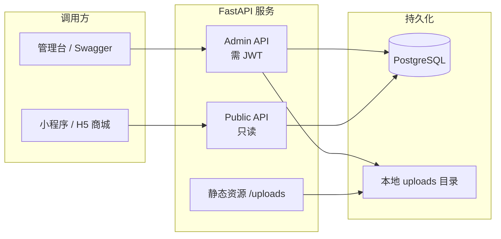
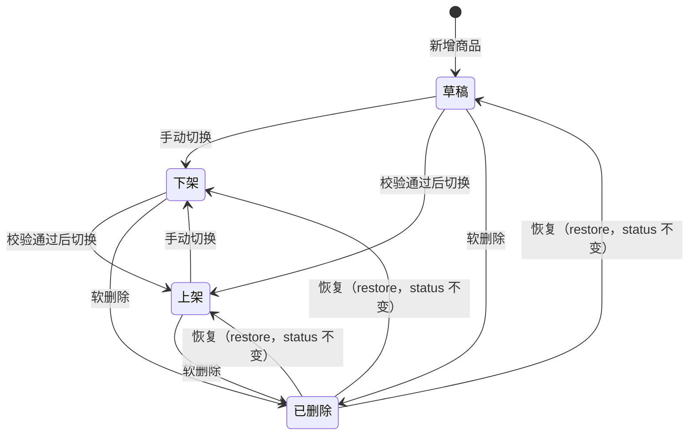
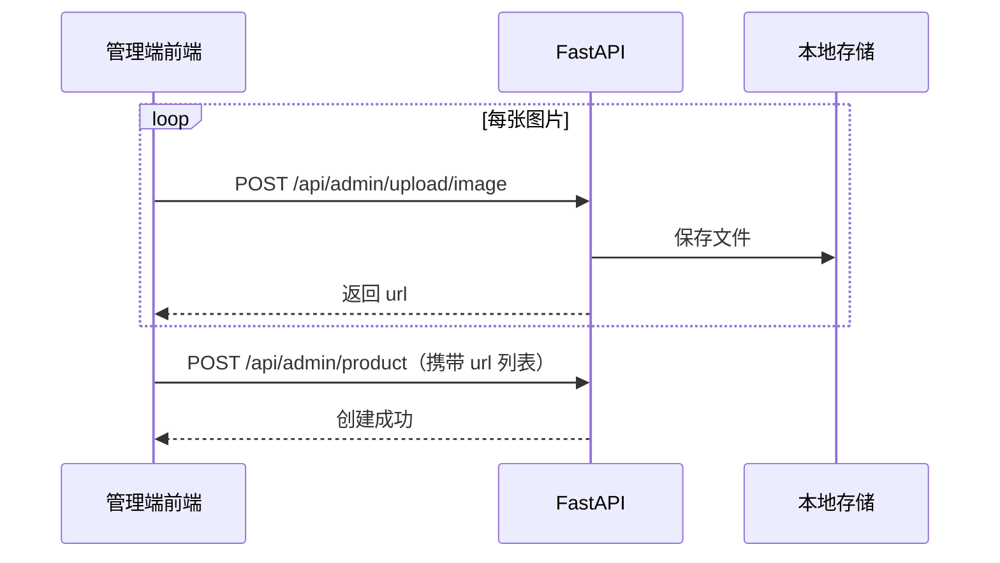
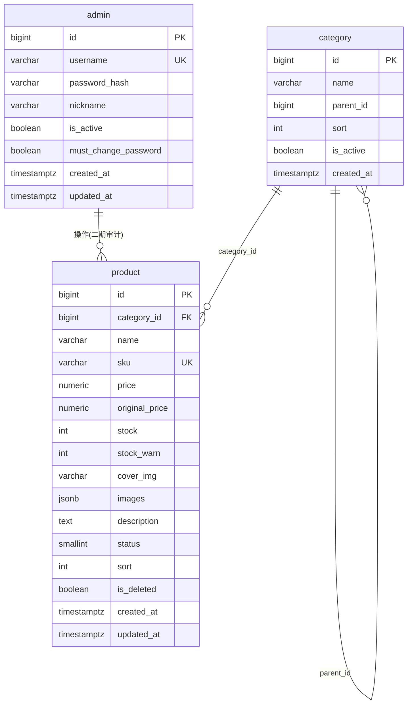

# 电商商品内容管理后台（FastAPI）需求文档

| 属性 | 内容 |
|------|------|
| 文档版本 | V1.2（终审） |
| 编写日期 | 2026-07-01 |
| 技术栈 | FastAPI + PostgreSQL + Docker Compose |
| 项目代号 | ECMS |

---

## 一、项目概述

### 1.1 项目背景

搭建轻量化**电商商品内容管理后台**，供运营人员维护商品与分类，输出标准化 REST API。

- **管理端（Admin API）**：运营人员的写操作入口，需 JWT 鉴权
- **商城端（Public API）**：小程序 / H5 商城的只读数据入口，无需登录

### 1.2 建设目标

#### 一期 MVP（P0，必须交付）

| 编号 | 目标 |
|------|------|
| G1 | 管理员登录鉴权、首次改密、登录限流 |
| G2 | 商品分类二级树 CRUD |
| G3 | 商品全生命周期：草稿 → 上下架、软删除、恢复、批量操作 |
| G4 | 图片上传、本地持久化、静态访问 |
| G5 | 商城只读 API（分类树、商品列表、商品详情） |
| G6 | Docker Compose 一键部署，数据库与文件持久化 |

#### 一期增强（P1，同期完成）

| 编号 | 目标 |
|------|------|
| G7 | 多条件分页筛选、低库存预警筛选 |
| G8 | Swagger 接口文档（开发环境） |

#### 二期（P2，暂不实现）

Redis 缓存、多角色 RBAC、操作审计日志、Excel 导入导出、MinIO 对象存储、Vue3 管理台 UI、孤立图片清理脚本。

### 1.3 用户角色

| 角色 | 一期权限 | 二期权限 |
|------|----------|----------|
| 超级管理员 | 全部管理端操作 | + 账号管理 |
| 运营人员 | 与超管共用账号，不区分 | 仅商品/分类读写 |

### 1.4 系统边界

**一期包含**：商品内容管理、分类管理、图片管理、Admin/Public API、Docker 部署。

**一期不包含**：

- 订单、支付、购物车、会员、优惠券、物流
- 完整 Vue 管理台前端（可并行另立项）
- Redis、分布式对象存储

### 1.5 架构概览



---

## 二、功能性需求

### 模块 1：认证模块

#### 1.1 管理员登录

| 项 | 说明 |
|----|------|
| 路径 | `POST /api/admin/auth/login` |
| 鉴权 | 无需 Token |
| 入参 | `username`（string）、`password`（string） |
| 逻辑 | BCrypt 校验密码；`is_active=false` 拒绝登录 |
| 限流 | 同一 IP 5 次/分钟，超出返回 `429` |
| 错误提示 | 统一返回「用户名或密码错误」，不区分账号是否存在 |

**响应示例**：

```json
{
  "code": 200,
  "msg": "登录成功",
  "data": {
    "access_token": "eyJhbGciOiJIUzI1NiIs...",
    "token_type": "bearer",
    "expires_in": 28800,
    "admin_id": 1,
    "nickname": "管理员",
    "must_change_password": true
  },
  "request_id": "a1b2c3d4-..."
}
```

#### 1.2 修改密码

| 项 | 说明 |
|----|------|
| 路径 | `POST /api/admin/auth/change-password` |
| 鉴权 | 需 Token |
| 入参 | `old_password`、`new_password`（≥ 8 位，含字母和数字） |
| 逻辑 | 校验旧密码 → 更新 → `must_change_password` 置为 `false` |

> **强制改密拦截**：当 `must_change_password=true` 时，仅允许调用 `change-password` 和 `GET /api/admin/auth/me`，其余 Admin 接口一律返回 `403`（需先修改密码）。

#### 1.3 获取当前登录信息

| 项 | 说明 |
|----|------|
| 路径 | `GET /api/admin/auth/me` |
| 鉴权 | 需 Token |
| 返回 | `admin_id`, `username`, `nickname`, `must_change_password` |

#### 1.4 鉴权规则

- 管理端接口请求头：`Authorization: Bearer {access_token}`
- JWT 有效期：**8 小时**（可通过 `JWT_EXPIRE_HOURS` 配置）
- 未登录 / Token 过期 → `401`；权限不足 → `403`（二期 RBAC 启用后）

#### 1.5 初始化超管

| 项 | 说明 |
|----|------|
| 时机 | 应用首次启动，admin 表为空时 |
| 用户名 | 环境变量 `ADMIN_USERNAME`，默认 `admin` |
| 密码 | 环境变量 `ADMIN_PASSWORD`，**必填，无默认值** |
| 行为 | 未配置 `ADMIN_PASSWORD` 时**拒绝启动**并输出明确错误 |

#### 1.6 健康检查

| 项 | 说明 |
|----|------|
| 路径 | `GET /api/health` |
| 鉴权 | 无需 Token |
| 返回 | `status`（ok/degraded）、`database`（connected/disconnected） |
| 用途 | Docker healthcheck、运维探活 |

---

### 模块 2：分类管理（Admin）

#### 2.1 字段规则

| 字段 | 类型 | 规则 |
|------|------|------|
| name | string | **同一 parent_id 下唯一** |
| parent_id | int | `0` = 一级分类；非 0 时父级必须是一级（**最多二级**） |
| sort | int | 越大越靠前，默认 0 |
| is_active | bool | 默认 true；禁用后 Public API 不返回 |

#### 2.2 业务约束

| 操作 | 约束 |
|------|------|
| 编辑 | 不可修改 `parent_id` |
| 禁用 | 该分类或子分类下存在**已上架**商品时禁止禁用 |
| 删除 | 存在子分类或关联商品（含软删除）时禁止删除 |

#### 2.3 接口清单

| 方法 | 路径 | 说明 |
|------|------|------|
| POST | `/api/admin/category` | 新增分类 |
| PUT | `/api/admin/category/{id}` | 编辑分类 |
| DELETE | `/api/admin/category/{id}` | 删除分类 |
| GET | `/api/admin/category/tree` | 全量树形结构（含禁用项） |
| GET | `/api/admin/category/list` | 分页列表，支持 `name` 模糊搜索 |

**分类列表查询参数**：`page`（默认 1）、`page_size`（默认 20，最大 100）、`name`（模糊搜索）、`parent_id`（可选，筛选某一级下的子分类）

**新增分类请求示例**：

```json
{
  "name": "手机数码",
  "parent_id": 0,
  "sort": 100,
  "is_active": true
}
```

---

### 模块 3：商品管理（Admin）

#### 3.1 字段定义

| 字段 | 创建必填 | 上架必填 | 说明 |
|------|:--------:|:--------:|------|
| category_id | ✓ | ✓ | 必须为**已启用的二级分类** |
| name | ✓ | ✓ | 展示名称，**允许重复** |
| sku | ✓ | ✓ | 商家编码，**全局唯一** |
| price | ✓ | ✓ | 售价，≥ 0 |
| original_price | — | — | 划线原价，若有则 ≥ price |
| stock | ✓ | ✓ | 库存，≥ 0 |
| stock_warn | — | — | 库存预警阈值，默认 10 |
| cover_img | — | ✓ | 封面图 URL，先上传后填入 |
| images | — | — | 图集 URL 数组，最多 9 张 |
| description | — | — | 富文本详情，入库前 HTML 白名单过滤 |
| sort | — | — | 分类内排序权重，默认 0 |
| status | — | — | 见状态机，默认 `0`（草稿） |

#### 3.2 商品状态机



| status 值 | 含义 | Public API 可见 |
|-----------|------|:---------------:|
| 0 | 草稿 | ✗ |
| 1 | 下架 | ✗ |
| 2 | 上架 | ✓（且 is_deleted=false） |

#### 3.3 上架校验

切换为「上架」（status=2）时，必须满足：

1. `cover_img` 非空
2. `price`、`stock` 合法
3. `category_id` 对应二级分类且 `is_active=true`
4. 父级一级分类 `is_active=true`

不满足时返回 `400`，说明具体缺失项。

#### 3.4 软删除与恢复

| 操作 | 路径 | 说明 |
|------|------|------|
| 软删除 | `DELETE /api/admin/product/{id}` | `is_deleted=true`，列表默认不展示 |
| 恢复 | `POST /api/admin/product/{id}/restore` | 清除删除标记，**status 保持删除前的值不变** |

列表查询支持 `include_deleted=true` 查看已删除商品。`is_deleted=true` 的商品**禁止编辑**，须先恢复。

**Public 商品详情**：访问下架/草稿/已删除商品时返回 `404`（不暴露存在性）。

#### 3.5 列表查询参数

| 参数 | 类型 | 说明 |
|------|------|------|
| page | int | 页码，默认 1 |
| page_size | int | 每页条数，默认 20，最大 100 |
| keyword | string | 模糊匹配 name 或 sku |
| category_id | int | 精确匹配分类 |
| status | int | 0/1/2 |
| include_deleted | bool | 默认 false |
| price_min / price_max | decimal | 价格区间 |
| stock_low | bool | true 时筛选 stock ≤ stock_warn |
| sort_by | string | `created_at` / `updated_at` / `price` / `stock` / `sort` |
| sort_order | string | `asc` / `desc`，默认 `desc` |

#### 3.6 批量上下架

| 项 | 说明 |
|----|------|
| 路径 | `PUT /api/admin/product/batch-status` |
| 入参 | `{ "ids": [1,2,3], "status": 2 }` |
| 返回 | 成功数、失败数、失败明细（id + 原因） |

#### 3.7 Admin 商品接口清单

| 方法 | 路径 | 说明 |
|------|------|------|
| POST | `/api/admin/product` | 新增商品 |
| PUT | `/api/admin/product/{id}` | 编辑商品 |
| DELETE | `/api/admin/product/{id}` | 软删除 |
| POST | `/api/admin/product/{id}/restore` | 恢复 |
| GET | `/api/admin/product/list` | 分页筛选列表 |
| GET | `/api/admin/product/{id}` | 商品详情 |
| PUT | `/api/admin/product/batch-status` | 批量改状态 |

**新增商品请求示例**：

```json
{
  "category_id": 5,
  "name": "无线蓝牙耳机 Pro",
  "sku": "SKU-BT-001",
  "price": 199.00,
  "original_price": 299.00,
  "stock": 100,
  "stock_warn": 10,
  "cover_img": "/uploads/2026/07/01/abc.jpg",
  "images": ["/uploads/2026/07/01/def.jpg"],
  "description": "<p>高品质降噪耳机</p>",
  "sort": 0,
  "status": 0
}
```

---

### 模块 4：商城只读 API（Public）

> 无需鉴权。仅返回 `status=2（上架）` 且 `is_deleted=false` 且分类链全部启用的数据。

| 方法 | 路径 | 说明 |
|------|------|------|
| GET | `/api/public/category/tree` | 启用状态的分类树 |
| GET | `/api/public/product/list` | 商品分页列表 |
| GET | `/api/public/product/{id}` | 商品详情 |

**Public 列表查询参数**：`page`、`page_size`、`keyword`、`category_id`、`sort_by`、`sort_order`

**Public 响应字段（相比 Admin 做裁剪）**：

| 返回 | 不返回 |
|------|--------|
| id, name, sku, price, original_price, stock, cover_img, images, description, sort, category_name | status, is_deleted, stock_warn, created_at（可选） |

---

### 模块 5：文件上传

#### 5.1 上传接口

| 项 | 说明 |
|----|------|
| 路径 | `POST /api/admin/upload/image` |
| 格式 | `multipart/form-data`，字段名 `file` |
| 支持格式 | jpg / jpeg / png / webp |
| 大小限制 | ≤ 5MB（`UPLOAD_MAX_MB` 可配置） |
| 安全校验 | MIME 类型 + 文件头魔数双重校验 |
| 物理存储 | 宿主机 `./data/uploads/{yyyy}/{mm}/{dd}/{uuid}.{ext}` |
| 容器内路径 | `/app/uploads/{yyyy}/{mm}/{dd}/{uuid}.{ext}` |
| 访问 URL | `/uploads/{yyyy}/{mm}/{dd}/{uuid}.{ext}`（由 FastAPI 静态路由映射） |
| 返回 | `{ "url": "/uploads/2026/07/01/xxx.jpg" }` |

#### 5.2 多图录入流程



一期通过**多次调用单文件接口**完成多图上传；二期可增加批量上传接口。

#### 5.3 图片清理

**一期不实现**自动清理脚本，由运维手动管理磁盘。二期提供孤立文件扫描工具。

---

### 模块 6：缓存（二期）

**引入条件**：商品数 > 5000 或 Public 列表 QPS > 50。

| 缓存 Key | TTL | 失效触发 |
|----------|-----|----------|
| `category:tree:public` | 30 min | 分类增删改 |
| `product:list:{params_hash}` | 10 min | 商品增删改、上下架 |

---

## 三、非功能性需求

### 3.1 性能指标

| 指标 | 目标值 | 测试条件 |
|------|--------|----------|
| 列表/详情 API 响应 | P95 ≤ 300ms | 1000 条数据、20 并发、本地 Docker |
| 分页查询 | 单次最大 100 条 | 默认 20 条 |
| 图片上传 | 5MB 文件 ≤ 3s | 本地网络 |

### 3.2 安全要求

| 项 | 措施 |
|----|------|
| 密码存储 | BCrypt，cost factor ≥ 12 |
| 文件上传 | 白名单扩展名 + 魔数校验，禁止 exe/php 等 |
| 入参校验 | Pydantic 模型强制校验 |
| SQL 注入 | ORM 参数化查询 |
| XSS | 富文本 `bleach` 白名单过滤 |
| CORS | 开发环境 `*`；生产通过 `CORS_ORIGINS` 白名单 |
| 接口文档 | `DEBUG=false` 时不暴露 `/docs` |
| 暴力破解 | 登录接口 IP 限流 5 次/分钟 |

### 3.3 部署方案

**服务组成（一期）**：

| 服务 | 镜像 | 说明 |
|------|------|------|
| api | 自构建 | FastAPI + Uvicorn |
| db | postgres:16-alpine | 数据卷持久化 |

**Compose 文件**：

| 文件 | 用途 |
|------|------|
| `docker-compose.yml` | 基础服务定义 |
| `docker-compose.dev.yml` | 热重载、源码挂载、DEBUG=true |
| `docker-compose.prod.yml` | 资源限制、日志轮转、DEBUG=false |

**数据卷挂载**：

| 宿主机路径 | 容器路径 | 内容 |
|------------|----------|------|
| `./data/postgres` | `/var/lib/postgresql/data` | 数据库 |
| `./data/uploads` | `/app/uploads` | 商品图片 |

**启动命令**：

```powershell
# 开发环境
docker compose -f docker-compose.yml -f docker-compose.dev.yml up -d

# 生产环境
docker compose -f docker-compose.yml -f docker-compose.prod.yml up -d
```

### 3.4 代码结构

```
ecms/
├── app/
│   ├── api/
│   │   ├── admin/          # 管理端路由（auth, category, product, upload）
│   │   └── public/         # 商城只读路由
│   ├── core/               # 配置、安全、依赖注入、异常处理
│   ├── models/             # SQLAlchemy ORM 模型
│   ├── schemas/            # Pydantic 请求/响应模型
│   ├── services/           # 业务逻辑层
│   └── main.py             # 应用入口
├── alembic/                # 数据库迁移
├── scripts/
│   └── init_db.py          # 初始化迁移 + 创建管理员
├── data/                   # 持久化目录（gitignore）
├── docker-compose.yml
├── docker-compose.dev.yml
├── docker-compose.prod.yml
├── Dockerfile
├── .env.example
├── requirements.txt
└── README.md
```

### 3.5 日志与异常

| 级别 | 场景 |
|------|------|
| INFO | 接口访问（method, path, status, duration） |
| WARNING | 业务校验失败、限流触发 |
| ERROR | 未捕获异常（记录 request_id，不向外暴露堆栈） |

---

## 四、数据结构设计

### 4.1 ER 关系



### 4.2 admin 管理员表

| 字段 | 类型 | 约束 | 说明 |
|------|------|------|------|
| id | BIGSERIAL | PK | |
| username | VARCHAR(50) | UNIQUE, NOT NULL | 登录账号 |
| password_hash | VARCHAR(255) | NOT NULL | BCrypt 哈希 |
| nickname | VARCHAR(50) | NOT NULL | 展示昵称 |
| is_active | BOOLEAN | DEFAULT true | 是否启用 |
| must_change_password | BOOLEAN | DEFAULT true | 首次登录须改密 |
| created_at | TIMESTAMPTZ | DEFAULT now() | |
| updated_at | TIMESTAMPTZ | DEFAULT now() | |

### 4.3 category 分类表

| 字段 | 类型 | 约束 | 说明 |
|------|------|------|------|
| id | BIGSERIAL | PK | |
| name | VARCHAR(100) | NOT NULL | 分类名称 |
| parent_id | BIGINT | DEFAULT 0 | 0 = 一级分类 |
| sort | INT | DEFAULT 0 | 排序权重 |
| is_active | BOOLEAN | DEFAULT true | 是否启用 |
| created_at | TIMESTAMPTZ | DEFAULT now() | |

**索引与约束**：

- `UNIQUE (parent_id, name)` — 同级分类名唯一
- `INDEX idx_category_parent (parent_id)`

### 4.4 product 商品表

| 字段 | 类型 | 约束 | 说明 |
|------|------|------|------|
| id | BIGSERIAL | PK | |
| category_id | BIGINT | NOT NULL, FK → category.id | 二级分类 |
| name | VARCHAR(200) | NOT NULL | 商品名称 |
| sku | VARCHAR(64) | UNIQUE, NOT NULL | 商家编码 |
| price | NUMERIC(10,2) | NOT NULL, CHECK ≥ 0 | 售价 |
| original_price | NUMERIC(10,2) | NULL | 划线原价 |
| stock | INT | DEFAULT 0, CHECK ≥ 0 | 库存 |
| stock_warn | INT | DEFAULT 10 | 预警阈值 |
| cover_img | VARCHAR(500) | NULL | 封面图 URL |
| images | JSONB | DEFAULT '[]' | 图集 URL 数组 |
| description | TEXT | NULL | 消毒后 HTML |
| status | SMALLINT | DEFAULT 0 | 0草稿 1下架 2上架 |
| sort | INT | DEFAULT 0 | 排序权重 |
| is_deleted | BOOLEAN | DEFAULT false | 软删除标记 |
| created_at | TIMESTAMPTZ | DEFAULT now() | |
| updated_at | TIMESTAMPTZ | DEFAULT now() | |

**索引**：

- `UNIQUE (sku)`
- `INDEX idx_product_category (category_id)`
- `INDEX idx_product_list (status, is_deleted, created_at DESC)`
- `INDEX idx_product_sku (sku)` — sku 已有唯一约束，可选冗余

---

## 五、API 规范

### 5.1 HTTP 状态码与响应体约定

| 场景 | HTTP Status | body.code |
|------|-------------|-----------|
| 成功 | 200 | 200 |
| 参数/业务错误 | 400 | 400 |
| 未登录/Token 失效 | 401 | 401 |
| 无权限/须先改密 | 403 | 403 |
| 资源不存在 | 404 | 404 |
| 请求过于频繁 | 429 | 429 |
| 服务异常 | 500 | 500 |

> HTTP 状态码与 body.code **保持一致**，便于前端 Axios 拦截器统一处理。

### 5.2 统一响应格式

**成功**：

```json
{
  "code": 200,
  "msg": "操作成功",
  "data": {},
  "request_id": "550e8400-e29b-41d4-a716-446655440000"
}
```

**失败**：

```json
{
  "code": 400,
  "msg": "分类名称已存在",
  "data": null,
  "request_id": "550e8400-e29b-41d4-a716-446655440000"
}
```

| code | 含义 |
|------|------|
| 200 | 成功 |
| 400 | 参数错误 / 业务校验失败 |
| 401 | 未登录或 Token 失效 |
| 403 | 无权限 |
| 404 | 资源不存在 |
| 429 | 请求过于频繁 |
| 500 | 服务内部异常 |

### 5.3 分页响应格式

```json
{
  "code": 200,
  "msg": "操作成功",
  "data": {
    "items": [],
    "total": 100,
    "page": 1,
    "page_size": 20,
    "pages": 5
  },
  "request_id": "..."
}
```

### 5.4 接口总览

#### Admin API（需 JWT）

| 模块 | 方法 | 路径 | 说明 |
|------|------|------|------|
| 认证 | POST | `/api/admin/auth/login` | 登录 |
| 认证 | GET | `/api/admin/auth/me` | 当前登录信息 |
| 认证 | POST | `/api/admin/auth/change-password` | 改密 |
| 分类 | POST | `/api/admin/category` | 新增 |
| 分类 | PUT | `/api/admin/category/{id}` | 编辑 |
| 分类 | DELETE | `/api/admin/category/{id}` | 删除 |
| 分类 | GET | `/api/admin/category/tree` | 树形列表 |
| 分类 | GET | `/api/admin/category/list` | 分页列表 |
| 商品 | POST | `/api/admin/product` | 新增 |
| 商品 | PUT | `/api/admin/product/{id}` | 编辑 |
| 商品 | DELETE | `/api/admin/product/{id}` | 软删除 |
| 商品 | POST | `/api/admin/product/{id}/restore` | 恢复 |
| 商品 | GET | `/api/admin/product/list` | 分页筛选 |
| 商品 | GET | `/api/admin/product/{id}` | 详情 |
| 商品 | PUT | `/api/admin/product/batch-status` | 批量改状态 |
| 上传 | POST | `/api/admin/upload/image` | 图片上传 |

#### Public API（无需鉴权）

| 方法 | 路径 | 说明 |
|------|------|------|
| GET | `/api/public/category/tree` | 启用分类树 |
| GET | `/api/public/product/list` | 商品分页列表 |
| GET | `/api/public/product/{id}` | 商品详情 |

#### 系统

| 方法 | 路径 | 说明 |
|------|------|------|
| GET | `/api/health` | 健康检查 |

---

## 六、部署与交付

### 6.1 交付清单

| 交付物 | 说明 |
|--------|------|
| 完整源码 | 含上述目录结构 |
| Dockerfile | 多阶段构建 |
| docker-compose 三件套 | base + dev + prod |
| `.env.example` | 环境变量模板 |
| `requirements.txt` | Python 依赖（锁定主版本） |
| `scripts/init_db.py` | 数据库初始化 |
| README.md | 启动指南、常见问题 |

### 6.2 访问地址

| 用途 | 地址 | 条件 |
|------|------|------|
| Swagger 文档 | http://127.0.0.1:8000/docs | DEBUG=true |
| 健康检查 | http://127.0.0.1:8000/api/health | 始终可用 |
| 图片资源 | http://127.0.0.1:8000/uploads/... | 始终可用 |

### 6.3 环境变量

| 变量 | 必填 | 默认值 | 说明 |
|------|:----:|--------|------|
| `DATABASE_URL` | ✓ | — | `postgresql+asyncpg://user:pass@db:5432/ecms` |
| `JWT_SECRET` | ✓ | — | ≥ 32 位随机字符串 |
| `JWT_EXPIRE_HOURS` | — | 8 | Token 有效期（小时） |
| `ADMIN_USERNAME` | — | admin | 初始管理员用户名 |
| `ADMIN_NICKNAME` | — | 管理员 | 初始管理员昵称 |
| `ADMIN_PASSWORD` | ✓ | — | 初始密码，未配置则拒绝启动 |
| `DEBUG` | — | false | true → 热重载 + Swagger |
| `CORS_ORIGINS` | — | * | 生产环境逗号分隔域名 |
| `UPLOAD_MAX_MB` | — | 5 | 单文件上传上限（MB） |

---

## 七、开发排期（建议）

| 阶段 | 时间 | 任务 | 产出 |
|------|------|------|------|
| W1-D1~D2 | 2天 | 项目骨架、Docker、数据库模型、Alembic 迁移 | 可启动的空服务 + 建表 |
| W1-D3~D4 | 2天 | 认证模块（登录、改密、JWT、限流） | Admin 可登录 |
| W1-D5 | 1天 | 分类 CRUD + 树形接口 | 分类管理可用 |
| W2-D1~D3 | 3天 | 商品 CRUD + 状态机 + 软删除恢复 + 批量操作 | 商品管理可用 |
| W2-D4 | 1天 | 图片上传 + 静态资源服务 | 图片流程打通 |
| W2-D5 | 1天 | Public API（分类树、商品列表、详情） | 商城可对接 |
| W3-D1~D2 | 2天 | 列表筛选排序、异常处理、日志、健康检查 | 功能完善 |
| W3-D3~D4 | 2天 | 联调测试、Docker 生产配置、README | 可部署交付 |
| W3-D5 | 1天 | 验收测试、Bug 修复 | 一期交付 |

---

## 八、迭代规划

### 一期（当前文档范围）

- Admin API + Public API
- 本地图片存储
- Docker Compose 部署
- 不含：Redis、管理台 UI、Excel 导入导出

### 二期

| 功能 | 说明 |
|------|------|
| 多角色 RBAC | 运营 / 超管权限分离 |
| 操作审计日志 | 记录操作人、时间、变更内容 |
| Redis 缓存 | 按引入条件启用 |
| MinIO / OSS | 替代本地文件存储 |
| Excel 导入导出 | 批量维护商品 |
| Vue3 管理台 | Element Plus 后台页面 |
| 图片清理脚本 | 扫描并清理孤立文件 |

---

## 九、验收标准

### 功能验收

- [ ] Swagger 可调试全部 Admin / Public 接口，无未处理 500
- [ ] 分类同级重名校验、二级层级限制、有关联时禁止删除
- [ ] 商品 SKU 唯一、草稿/上下架状态机正确
- [ ] 上架校验（封面图、分类启用等）生效，批量操作返回失败明细
- [ ] 软删除与恢复功能正常
- [ ] Public API 不返回草稿/下架/已删除商品
- [ ] 图片上传与访问正常；容器重启后数据与文件均保留

### 安全验收

- [ ] 未配置 `ADMIN_PASSWORD` 时服务拒绝启动
- [ ] 首次登录 `must_change_password` 流程完整
- [ ] 登录限流生效；错误提示不泄露账号是否存在
- [ ] 生产环境（DEBUG=false）不暴露 Swagger

### 部署验收

- [ ] Windows Docker Desktop 下 `docker compose up` 一键启动成功
- [ ] `GET /api/health` 返回 database=connected
- [ ] 删除并重建容器后，数据库与 uploads 数据完整保留

---

## 附录 A：V1.0 → V1.1 修订记录

| 类别 | V1.0 原方案 | V1.1 优化 |
|------|------------|-----------|
| 范围 | 一期含 Redis | Redis 移至二期，降低部署复杂度 |
| 架构 | 仅 Admin API | 拆分 Admin + Public 双端 API |
| 范围 | 前端页面未明确 | 一期仅 API，Vue 管理台二期 |
| 分类 | 名称全局唯一 | 改为同 parent_id 下唯一 |
| 商品 | 名称全局唯一 | 名称可重复，SKU 唯一 |
| 商品 | 无草稿状态 | 增加草稿态，上架时校验必填 |
| 商品 | 软删除不可恢复 | 增加 restore 接口 |
| 安全 | 默认密码 123456 | 环境变量注入 + 首次强制改密 |
| 安全 | 登录错误区分账号/密码 | 统一提示，防枚举 |
| 性能 | 响应 ≤ 200ms 硬指标 | P95 ≤ 300ms 务实指标 |
| 字段 | 缺少 SKU/原价/预警 | 补充 sku、original_price、stock_warn |
| 部署 | 开发生产配置混合 | 拆分 dev / prod Compose |

## 附录 B：V1.2 终审修订（开发前确认）

| 项 | 修订内容 |
|----|----------|
| 强制改密 | 明确 `must_change_password=true` 时仅允许 me + change-password |
| 当前用户 | 新增 `GET /api/admin/auth/me` |
| HTTP 约定 | HTTP Status 与 body.code 保持一致 |
| 存储路径 | 统一物理路径 / 容器路径 / 访问 URL 三层说明 |
| 软删除编辑 | 已删除商品禁止编辑，须先恢复 |
| Public 详情 | 不可见商品返回 404 |
| 分类列表 | 补充分页与筛选参数 |
| 初始化 | 补充 `ADMIN_NICKNAME` 环境变量 |

**终审结论**：文档可进入开发，无阻塞性歧义。

## 附录 C：技术选型说明

| 技术 | 选型理由 |
|------|----------|
| FastAPI | 异步高性能、自动生成 OpenAPI、Pydantic 校验 |
| PostgreSQL 16 | JSONB 存图集、事务可靠、索引扩展性好 |
| SQLAlchemy 2.0 + asyncpg | 异步 ORM，与 FastAPI 生态契合 |
| Alembic | 数据库版本化管理，安全迭代表结构 |
| 本地 uploads | MVP 单机部署足够，二期抽象 Storage 接口 |
| 暂不引入 Redis | 减少依赖，降低 Windows 本地部署失败率 |
