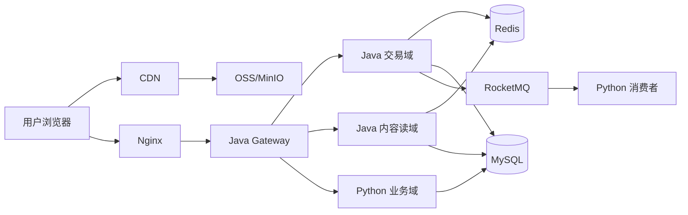

# 宇小兔每日读书 · 技术选型定版方案

| 项目 | 说明 |
|------|------|
| 文档版本 | **v1.2（与 Dev PRD v1.8 对齐）** |
| 定版日期 | 2026-07-02 |
| **开发者** | **潘宇**（单人全栈 · Java 5 年 + Python） |
| 开发模式 | **单人全栈** |
| 适用范围 | **Customer-YuXiaotuBook**（C 端主站） |
| 目标规模 | 百万注册用户；峰值读 **5k～20k QPS**；支付/下单 **强一致** |
| 关联项目 | `Admin-YuXiaoTuBook`（独立 ECMS，不并入 C 端主链路） |
| 关联文档 | [《宇小兔每日读书网站 · 开发需求文档（Dev PRD）》](./宇小兔每日读书网站%20·%20开发需求文档（Dev%20PRD）.md) **v1.8**（§2.5 扩展触发 · §1.10 八次评审）· **[《技术选型.md》](./技术选型.md)（Python/Java 接口执行定版）** |

---

## 〇、定版结论（1 分钟读完）

| 问题 | 定版答案 |
|------|----------|
| 要不要全站换 Java？ | **否**。Java 接「网关 + 交易 + 热点读」；Python 保留 Admin / 运营 / AI |
| 百万用户靠什么？ | **CDN + Redis + MySQL 主从 + MQ + 多实例**，先于换语言 |
| 视频怎么扛流量？ | **HLS + CDN 签名**，应用层不扛视频字节流 |
| 现有 FastAPI 怎么办？ | **不废弃**，按 API 路径逐步把流量切到 Java 新服务 |
| ECMS 后台怎么办？ | `Admin-YuXiaoTuBook` **独立**，仅未来商品同步时 MQ/HTTP 对接 |

**定版一句话：**

> 百万用户 = 基础设施先行 + 双栈分工；Java 负责网关、订单支付、热点读；Python 负责 Admin、每日专栏、偏好、AI 与快速迭代。

> **单人开发**：见 **§十一**，采用「Python 为主 + 单 Java 交易服务」轻量协同；本章 §一～§六 为 **目标架构**，团队扩容后再逐步对齐。

---

## 一、总体架构

```text
                    ┌─────────────────────────────────────┐
                    │  CDN（HLS 视频 + 封面 + 前端静态）    │
                    └─────────────────────────────────────┘
                                      │
用户 ──► Nginx ──► Java API Gateway ──┬──► Java 交易域（订单/支付/会员）
                                      ├──► Java 内容读域（书单/play-auth）
                                      └──► Python 业务域（Admin/每日/偏好/AI）
                                                │
                    Redis 集群 ◄────────────────┤
                    MySQL 主从 ◄────────────────┤
                    RocketMQ   ◄── 异步写/通知 ──┤
                    OSS/MinIO  ◄── 媒资/上传 ────┘
```



---

## 二、语言与服务边界（定版）

### 2.1 服务清单

| 域 | 语言 | 框架 | 仓库（规划） | 职责 |
|----|------|------|--------------|------|
| **网关** | Java | Spring Cloud Gateway 4.x | `yuxiaotu-gateway` | 路由、JWT 校验、限流、熔断、灰度 |
| **交易域** | Java | Spring Boot 3.2 + MyBatis-Plus | `yuxiaotu-trade-service` | 图书订单、库存、支付、会员开通、幂等与对账 |
| **内容读域** | Java | Spring Boot 3.2 + MyBatis-Plus | `yuxiaotu-catalog-service` | 首页、书单、分类、详情只读、相似推荐、play-auth |
| **业务域** | Python | FastAPI + Tortoise/Aerich | `Customer-YuXiaotuBook/backend` | Admin CRUD、每日读书、偏好、用户管理树、AI |
| **C 端前端** | Vue 3 | Vite + Pinia | `Customer-YuXiaotuBook/frontend` | 用户站（端口 **5188**） |
| **ECMS** | Python | FastAPI + PostgreSQL | `Admin-YuXiaoTuBook` | 独立商品内容管理，**不并入 C 端主链路** |

### 2.2 API 路径归属（与现有实现对齐）

#### 迁移至 Java（按阶段切流量）

| 方法 | 路径 | 目标服务 | 阶段 |
|------|------|----------|------|
| GET | `/api/v1/books` | catalog | P2 |
| GET | `/api/v1/books/{id}` | catalog（只读） | P2 |
| GET | `/api/v1/books/{id}/play-auth` | catalog | P2 |
| GET | `/api/v1/books/{id}/similar` | catalog | P2 |
| GET | `/api/v1/home/*` | catalog | P2 |
| GET | `/api/v1/categories` | catalog | P2 |
| POST | `/api/v1/orders` | trade | P1 |
| GET | `/api/v1/orders*` | trade | P1 |
| POST | `/api/v1/orders/{id}/mock-pay` | trade | P1 |
| POST | `/api/v1/orders/{id}/cancel` | trade | P1 |
| POST | `/api/v1/member/subscribe` | trade | P1 |
| POST | `/api/v1/member/orders/{id}/mock-pay` | trade | P1 |
| GET | `/api/v1/member/packages` | catalog 或 trade | P1 |
| GET | `/api/v1/member/status` | trade | P1 |
| POST | 微信/支付宝回调 | trade | P5 |

#### 永久保留 Python

| 方法 | 路径 | 说明 |
|------|------|------|
| * | `/api/v1/admin/*` | 运营后台 |
| * | `/api/v1/daily/*`（Admin 写） | 每日专栏运营 |
| GET/PUT | `/api/v1/user/preferences` | 读书喜好 |
| GET | `/api/v1/user/orders/shipping` | 收发货（只读，可调 trade） |
| * | `/api/v1/admin/users/*` | 用户管理树 |
| POST | `/api/v1/auth/register` | 注册（前期 Python；用户量极大后可迁 Java） |
| POST | `/api/v1/auth/login` | 登录 |
| POST/GET/DELETE | `/api/v1/favorites` | 收藏 |
| GET | `/api/v1/history` | 浏览记录（写入改 MQ 异步） |
| POST | `/api/v1/books/{id}/play-report` | 播放统计（改 MQ 异步） |

### 2.3 JWT 与鉴权定版

| 项 | 定版 |
|----|------|
| 算法 | HS256（与现网一致，便于双栈共存） |
| 密钥 | Java / Python **共用** `JWT_SECRET` |
| Payload | `{ sub: user_id, role: user\|admin, exp }` |
| 校验位置 | **Gateway 统一验签**；下游服务信任网关或二次校验 |

---

## 三、基础设施定版

| 组件 | 定版选型 | 用途 | 当前状态 |
|------|----------|------|----------|
| 关系库 | **MySQL 8.0** | 主业务数据 | ✅ 已有 |
| 缓存 | **Redis 7 集群** | 热点书单、play-auth、限流、分布式锁 | ❌ 未接入（**P0 必装**） |
| 消息队列 | **RocketMQ 5.x** | 浏览记录、play-report、发货/支付异步 | ❌ 未接入（P4） |
| 对象存储 | 生产 **OSS** / 开发 **MinIO** | 封面、视频源 | 🔶 MinIO 规划有，常未启 |
| CDN | 阿里云 / 腾讯云 CDN | HLS、封面、静态资源 | ❌ 待做（P0/P3） |
| 视频协议 | **HLS + CDN 签名 URL** | 试看/全片鉴权 | ❌ 当前 MP4 直链（过渡） |
| 搜索 | Phase 3：**Elasticsearch 8** | 书单全文检索 | 一期 `LIKE` + Redis 够用 |
| 反向代理 | **Nginx** | TLS、静态、反代 Gateway | 生产必 HTTPS |

### 3.1 数据一致性定版

| 场景 | 策略 |
|------|------|
| 库存扣减 | **支付成功时**扣减；Redis 预扣 + MySQL `SELECT FOR UPDATE` |
| 下单占库存 | 下单 **不扣** 库存；仅校验 `stock >= qty` |
| 订单幂等 | `client_token` 或业务单号唯一索引；支付回调 idempotent key |
| 未支付订单 | 30 分钟超时取消（定时任务 / MQ 延迟消息） |
| 浏览记录 / play-report | **异步** MQ 落库，不阻塞详情页 |
| 会员状态 | trade 域写 `user_member`；Python Admin 只读或调 trade API |

---

## 四、各层技术栈明细

### 4.1 Java 侧（新建）

| 项 | 定版 |
|----|------|
| JDK | **17 LTS** |
| 框架 | Spring Boot **3.2**、Spring Cloud Gateway **4.x** |
| ORM | MyBatis-Plus |
| 连接池 | HikariCP |
| 缓存/锁 | Spring Data Redis + **Redisson** |
| API 文档 | SpringDoc OpenAPI |
| 构建 | Maven **3.9** |
| 包名建议 | `com.yuxiaotu.trade` / `com.yuxiaotu.catalog` / `com.yuxiaotu.gateway` |

### 4.2 Python 侧（保留演进）

| 项 | 定版 |
|----|------|
| 运行时 | Phase 1 维持 **3.8.10** → Phase 2 升 **3.11** |
| 框架 | FastAPI **0.109.2** + Tortoise-ORM + Aerich |
| 部署 | Gunicorn + Uvicorn workers，**2～4 worker/实例** |
| 职责 | Admin、每日、偏好、用户管理、AI、迁移脚本 |

### 4.3 前端定版

| 项 | 定版 |
|----|------|
| C 端 | Vue 3 + TypeScript + Vite + Pinia |
| C 端端口 | **5188** |
| Admin UI | 同仓库 `/admin` + Element Plus |
| Admin 入口 | 仅 `/admin/login`，顶栏不暴露 |
| SEO | CSR + `sitemap.xml`；Phase 3 评估 SSR/Nuxt |

### 4.4 Admin-YuXiaoTuBook（ECMS）定版

| 项 | 定版 |
|----|------|
| 定位 | 电商商品内容管理，**独立产品** |
| 技术栈 | FastAPI + PostgreSQL + Vue admin-web |
| 端口 | API **8001**，前端 **5173** |
| 与 C 端关系 | 不做强耦合；未来商品同步经 **MQ 或 HTTP** |

---

## 五、部署与运维定版

| 项 | 定版 |
|----|------|
| 开发环境 | Docker Compose（`Customer-YuXiaotuBook/deploy`） |
| 生产环境 | **多实例** ECS 或 **Kubernetes**（单容器不上百万） |
| CI/CD | GitHub Actions / 云效：Java Maven + Python 镜像 + 前端 OSS |
| 配置中心 | 环境变量 → Phase 2 起 **Nacos / Apollo** |
| 日志 | JSON 结构化 + 云日志 / ELK |
| 监控 | Prometheus + Grafana；链路 **SkyWalking** |
| 压测 | **k6 / JMeter**；P1 交易链路必压 |

### 5.1 生产逻辑拓扑（定版）

```text
nginx
  └── gateway (Java, 多实例)
        ├── trade-service (Java, 多实例)
        ├── catalog-service (Java, 多实例)
        └── api (Python FastAPI, 多实例)
mysql-master + mysql-slave
redis-cluster
rocketmq
oss + cdn
```

### 5.2 当前开发 Compose（现状）

`Customer-YuXiaotuBook/deploy/docker-compose.yml`：

| 服务 | 容器名 | 端口 |
|------|--------|------|
| mysql | yuxiaotu-mysql | 3306 |
| minio | yuxiaotu-minio | 9000/9001 |
| api | YuXiaotuBook | 8000 |

> **定版要求**：P0 起 compose 增加 **Redis**；Java 服务加入同一 compose 或独立 compose 联调。

---

## 六、分阶段实施路线图（锁死优先级）

| 阶段 | 时间盒 | 交付物 | 负责栈 |
|------|--------|--------|--------|
| **P0 基线** | 2～3 周 | Redis；连接池调优；FastAPI 多 worker；封面 CDN | Python + 基础设施 |
| **P1 交易** | 4～6 周 | `yuxiaotu-trade-service` + Gateway 路由订单/会员/支付 | **Java** |
| **P2 读路径** | 3～4 周 | `yuxiaotu-catalog-service`；books/home/play-auth + Redis 缓存 | **Java** |
| **P3 视频** | 4 周 | HLS 转码 + CDN 签名；试看 enforcement 服务端化 | Java + CDN |
| **P4 异步** | 2 周 | RocketMQ：history、play-report、订单通知 | Java 生产 + Python 消费 |
| **P5 真实支付** | 3 周 | 微信/支付宝回调进 trade-service | **Java** |
| **P6 搜索/推荐** | 按需 | ES 或偏好推荐加权 | Python 为主 |

**定版原则：**

1. 未完成 **P0**，不启动 **P1**  
2. 未完成 **P1**，不上 **真实支付（P5）**  
3. 未完成 **P3**，不把 MP4 直链当生产终态  

---

## 七、仓库结构定版

```text
YuXiaoTuAIGC/
├── Customer-YuXiaotuBook/       # Python 业务域 + C 端前端（保留）
│   ├── backend/
│   ├── frontend/
│   └── deploy/
├── yuxiaotu-gateway/              # Java 新建
├── yuxiaotu-trade-service/        # Java 新建
├── yuxiaotu-catalog-service/      # Java 新建
├── Admin-YuXiaoTuBook/            # 独立 ECMS（不动）
└── 开发文档/
    └── 前台文档/
        ├── 宇小兔每日读书网站 · 开发需求文档（Dev PRD）.md
        └── 技术选型定版.md          # 本文档
```

---

## 八、明确不做（Won't）

| 项 | 原因 |
|----|------|
| 全站 Java 重写 | Admin/AI 迭代成本高，收益低 |
| 应用服务器扛视频流量 | 必须 CDN + HLS |
| 单机 Docker 扛生产百万用户 | 必须水平扩展 + 缓存 + 主从 |
| MP4 直链作为终态 | 无法防盗链与服务端试看 enforcement |
| C 端与 ECMS 合并为一个后端 | 边界混乱，运维耦合 |
| 一期上 Elasticsearch | 数据量不足，LIKE + Redis 先行 |

---

## 九、风险与对策

| 风险 | 对策 |
|------|------|
| 双栈 JWT/数据不一致 | 共用密钥；trade 写库为会员/订单权威源 |
| Python 3.8 与 Java 17 并存 | 新 Java 独立仓库；Python 按 Phase 2 升级 |
| 切流量回滚 | Gateway 按路径灰度；保留 Python 接口一段时间 |
| 库存超卖 | trade 域 Redis 锁 + 事务；压测验证 |
| 视频成本 | CDN 带宽监控；试看码率限制 |

---

## 十、与 Dev PRD 的关系

| 文档 | 关系 |
|------|------|
| Dev PRD | 描述 **产品功能与页面**；本定版描述 **技术架构与语言边界** |
| 冲突时 | **产品行为以 Dev PRD 为准**；**性能与扩展以本定版为准** |
| 后续 | P1 开工时维护 **[《P1 交易域 Java 接口对照表》](./P1-交易域Java接口对照表.md)** |

---

## 十一、单人开发简化版（1 人全栈 · 轻量协同）

> **适用**：当前仅 **1 名开发者**（Java 背景、会 Python），维护 `Customer-YuXiaotuBook` MVP 并继续迭代功能。  
> **原则**：目标架构（§一～§六）不变；**实施路径降级**，避免 Gateway + 3 个 Java 服务同时维护。

### 11.1 三种路线对比（单人视角）

| 路线 | 维护成本 | 上线速度 | 百万级潜力 | 单人推荐 |
|------|----------|----------|------------|----------|
| **纯 Java 重写整站** | 中（一种语言） | ❌ 最慢（3～6 个月重写） | ✅ | ⭐ 不推荐 |
| **Java + Python（完整微服务）** | ❌ 最高（Gateway + trade + catalog + Python） | 慢 | ✅✅ | ⭐⭐ 团队 ≥3 人时再上 |
| **Java + Python（轻量协同）** | ✅ 可控 | ✅ 最快 | ✅（P0 基础设施到位后） | ⭐⭐⭐⭐⭐ **当前采用** |

**定版结论（单人）**：**采用轻量协同**——Python 扛主站 + Admin；**仅新增 1 个 Java 交易服务**；Nginx 按路径分流，**暂不单独建设 Gateway 与 catalog-service**。

### 11.2 单人简化拓扑（与 §一 的差异）

```text
                    CDN（封面 / 后续 HLS）
                              │
用户 ──► Nginx ──按路径───────┬──► Python FastAPI（默认：Admin / 书单 / 每日 / 偏好 / 登录）
                              │
                              └──► Java trade-service（仅：订单 / 会员支付 / 库存）
                                        │
                              Redis + MySQL（共用，JWT 密钥共用）
```

| 完整定版（§一） | 单人简化版（§十一） |
|-----------------|---------------------|
| Spring Cloud Gateway | **Nginx `location` 分流**，够用再换 Gateway |
| trade + catalog 两个 Java 服务 | **仅 trade**；书单读路径继续 Python + Redis |
| RocketMQ 尽早接入 | **P4 再接入**；前期可用 DB 直写 + 定时任务 |
| Redis 集群 | **单机 Redis** 即可（开发 / 早期生产） |
| Python 3.8 → 3.11 | **功能稳定后再升**，不与其他改造并行 |

### 11.3 语言分工（单人锁死）

| 模块 | 语言 | 单人阶段是否迁移 |
|------|------|------------------|
| Admin 全套 CRUD | Python | ❌ **永不迁**（除非团队扩容） |
| 每日读书 / 偏好 / 用户管理树 | Python | ❌ 不迁 |
| 登录注册 / 收藏 / 浏览记录 | Python | ❌ 前期不迁 |
| 书单 / 首页 / play-auth | Python + **Redis 缓存** | ❌ P2 前不拆 Java；缓存先顶 |
| **订单 / mock-pay / 会员开通** | **Java（trade）** | ✅ **唯一优先新建的 Java 服务** |
| 微信 / 支付宝回调 | Java（trade） | ✅ 与 P1 同域 |
| AI / 推荐 / 脚本 | Python | ❌ 不迁 |

### 11.4 单人分阶段路线图（务实版）

| 阶段 | 时间盒（业余） | 交付 | 栈 |
|------|----------------|------|-----|
| **S0 现在** | 持续 | 产品功能迭代（Dev PRD 待办） | Python |
| **S1 基线** | 2～3 周 | Docker Compose **+ Redis**；连接池；FastAPI 多 worker；封面 CDN | Python + Redis |
| **S2 交易** | 4～6 周 | 新建 **`yuxiaotu-trade-service`**；Nginx 转发 `/api/v1/orders*`、`/api/v1/member/subscribe*` 等 | **Java** |
| **S3 视频** | 3～4 周 | HLS + CDN 签名（仍可不拆 catalog Java） | Python/Java + CDN |
| **S4 真实支付** | 3 周 | 回调进 trade-service | Java |
| **S5 扩容** | 团队 ≥2 人或 QPS 瓶颈 | 再评估 catalog-service、Gateway、MQ 集群 | 对齐 §一 目标架构 |

**单人铁律：**

1. **同一时期只做一个「大改造」**（例如 S2 做 Java 交易时，不并行 HLS + Python 升 3.11）。  
2. **未完成 S1（Redis），不启动 S2（Java trade）**。  
3. **Admin 永远留 Python**，节省至少 30% 维护时间。

### 11.5 Nginx 分流示例（替代 Gateway · 单人期）

```nginx
# 交易路径 → Java trade（端口 8081）
location ~ ^/api/v1/(orders|member/subscribe|member/orders) {
    proxy_pass http://127.0.0.1:8081;
}

# 其余 → Python FastAPI（端口 8000）
location /api/ {
    proxy_pass http://127.0.0.1:8000;
}
```

JWT：`trade-service` 与 Python **共用** `JWT_SECRET`，校验逻辑与 §2.3 一致。

### 11.6 何时从「单人简化版」升级到「完整定版」

| 触发条件 | 升级动作 |
|----------|----------|
| 读接口 P95 > 500ms 且 Redis 仍不够 | 拆 **catalog-service** 或 MySQL 只读副本 |
| 需灰度 / 多团队并行发版 | 引入 **Spring Cloud Gateway** |
| 浏览记录 / 支付通知拖慢主链路 | 引入 **RocketMQ** |
| 开发 ≥ 2 人专职后端 | 按 §一 完整拓扑实施 |
| 仅 DAU 增长、QPS 正常 | **保持单人简化版，不超前拆服务** |

### 11.7 单人仓库结构（当前只需这些）

```text
YuXiaoTuAIGC/
├── Customer-YuXiaotuBook/     # Python 主站（继续作为主仓库）
├── yuxiaotu-trade-service/    # Java 新建（S2 再创建，仅 1 个）
├── Admin-YuXiaoTuBook/        # ECMS 独立（按需，非 C 端必经）
└── 开发文档/前台文档/
    └── 技术选型定版.md
```

`yuxiaotu-gateway`、`yuxiaotu-catalog-service`：**单人阶段仅写在规划里，不创建仓库。**

### 11.8 给 Java 背景单人开发者的执行建议

| 建议 | 说明 |
|------|------|
| **不要纯 Java 重写** | 已有 Python MVP + 冒烟测试，重写 ROI 为负 |
| **Java 用在交易域** | 发挥 5 年 Java 经验：事务、库存、支付、幂等 |
| **Python 用在运营与迭代** | Admin、每日、偏好、脚本一天能改完的功能 |
| **先 Redis 后 Java** | 很多「慢」是缺缓存，不是缺 Java |
| **ECMS 与 C 端分离** | `Admin-YuXiaoTuBook` 不要并入 C 端 compose |

---

详细字段对照见 **[《P1 交易域 Java 接口对照表》](./P1-交易域Java接口对照表.md)**（S2 开工清单）。

---

## 附录 A：P1 交易域 Java 服务范围（预览）

| 模块 | 接口 | 数据表 |
|------|------|--------|
| 图书订单 | create / list / detail / cancel / mock-pay | `order`, `order_item` |
| 会员 | subscribe / mock-pay / status | `member_order`, `user_member`, `member_package` |
| 库存 | 支付成功扣减 | `book.stock` |
| 幂等 | 支付回调、重复下单 | 唯一索引 + Redis |

完整接口、DTO、错误码、上线清单见 **[《P1 交易域 Java 接口对照表》](./P1-交易域Java接口对照表.md)**。

---

## 附录 B：版本变更日志

| 版本 | 日期 | 说明 |
|------|------|------|
| v1.0 | 2026-07-02 | 首版定版：双栈分工、基础设施、六阶段路线图、API 归属 |
| v1.1 | 2026-07-02 | 新增 **§十一 单人开发简化版**：轻量协同、Nginx 分流、S0～S5 务实路线 |
| v1.2 | 2026-07-02 | 开发者 **潘宇**；与 Dev PRD v1.8 交叉引用；扩展触发以 PRD §2.5 为准 |

---

*本文档为 Customer-YuXiaotuBook 百万级扩展的技术选型定版（开发者：**潘宇**）。§一～§六 为目标架构；**单人开发以 §十一 为实施准绳**，扩展节奏以 Dev PRD **§2.5** 触发条件为准，团队扩容后再对齐完整定版。*
